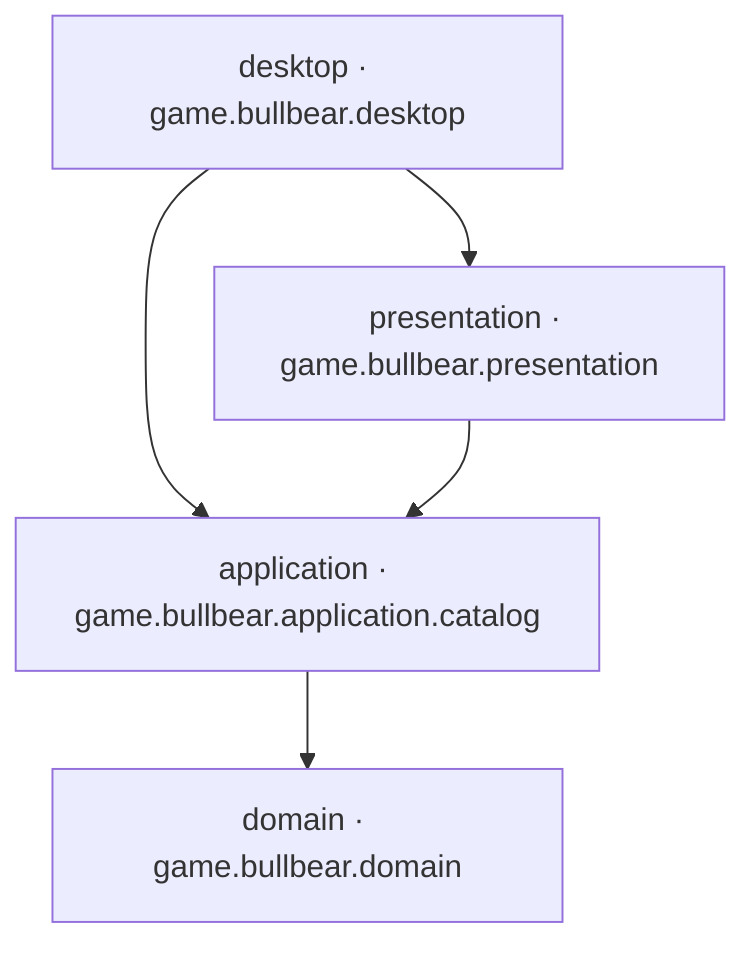
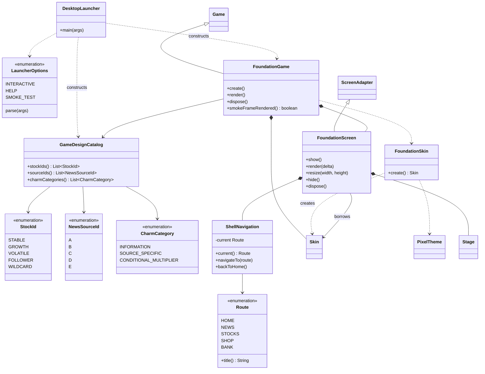

# Current foundation diagrams

Arrows in the first diagram represent direct Gradle project dependencies. The domain API is visible through the Java Library contract of `application`. The desktop backend is declared only in `desktop`.

The launcher constructs the catalog and game. The game owns the screen and skin, and the screen owns its stage and navigation. The screen rebuilds its placeholder content when the selected route changes.

The [architecture overview](overview.md) documents future package ownership. These diagrams correspond to the Phase 01 source.
