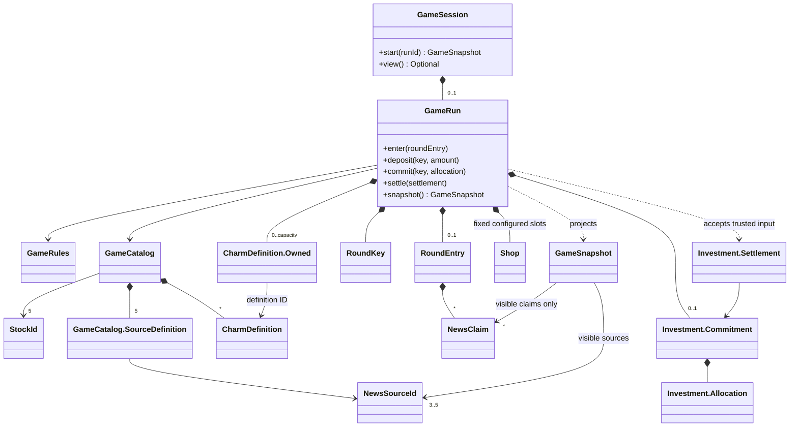
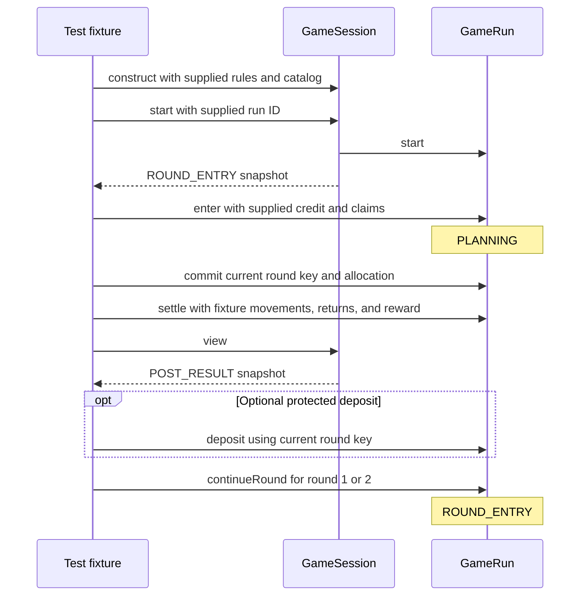

# Phase 02 domain model

`GameRun` is the only mutable owner of a run. A single coordinator thread applies commands. The run owns the wallet, cumulative bank, special currency, inventory, shop and current round. `GameRules` and `GameCatalog` are immutable supplied configuration. The existing `GameDesignCatalog` continues to expose the same enum identities for the desktop shell.

`GameSession` starts a run from supplied rules and returns immutable `GameSnapshot` values. Only application code in the session package can access its active aggregate. The desktop composition root uses the existing shell setup and does not create a session. Trusted domain inputs include a complete `RoundEntry` and an already-computed `Investment.Settlement`. Market and economy algorithms can construct these inputs in subsequent phases.

Allocation maps and movement maps use stock enum order. Catalog sources and projected source sets use source enum order. Claims and owned charms retain supplied and acquisition order respectively. Shop slot IDs are one-based positions. A round entry keeps its full claim list internally. The projection strips hidden claims and exposes the immutable investment result only after settlement.

## Structural round sequence

The application integration test reaches the aggregate through its trusted package. The desktop owns the separate scene navigation. See the [actual transitions](game-state-machine.md) and [module boundaries](overview.md).
