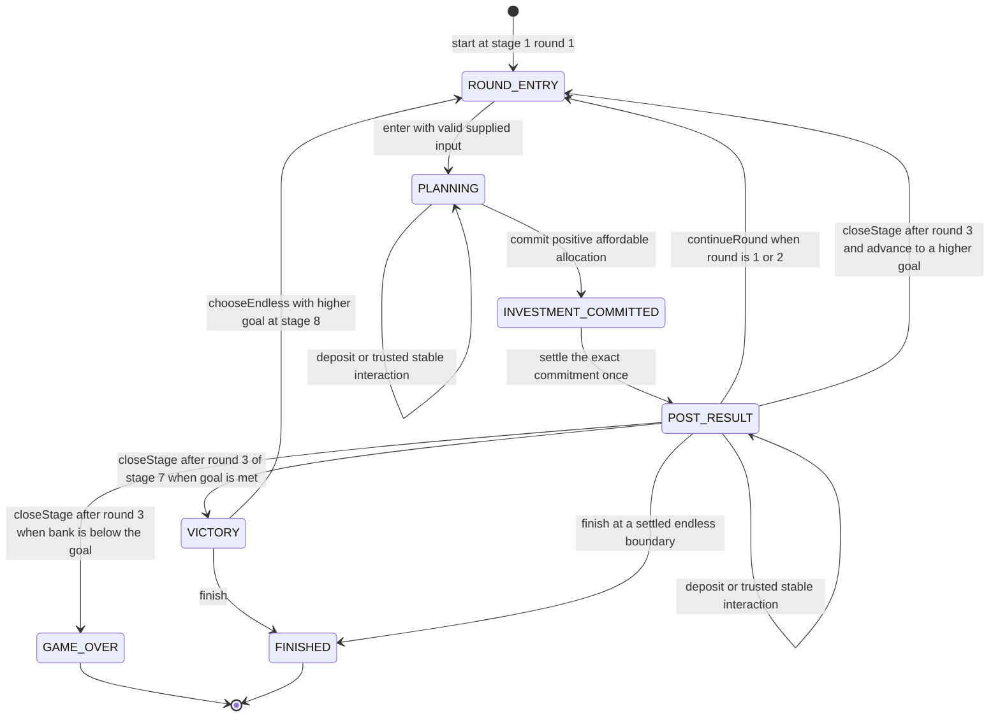

# Phase 02 game state machine

The run key is a caller-supplied positive run ID plus one-based stage and round indices. Every transition checks the key and phase. `closeStage` atomically assesses the bank when the final deposit window closes.

| Command | Guards and state effects |
|---|---|
| `enter` | Exclusive to entry. Apply the supplied credit to the wallet before planning. Initial funds cover the first round. |
| `deposit` | Planning and post-result. Transfer the positive affordable amount to the bank atomically. Drafts are detached values and affordability is recalculated on confirmation. |
| `commit` | Planning. Debit the stake once and retain the exact immutable commitment. |
| `settle` | Committed. Validate and apply one payout, optional reward and optional complete offer rotation. Clear the stake and keep a safe result. |
| `continueRound` | After settlement of round 1 or 2. Retire round-local data and open a new entry. |
| `closeStage` | After settlement of round 3. Bank equality passes. Campaign goals use the configured schedule. An endless success requires a supplied higher goal. |
| `chooseEndless`, `finish` | Victory offers an explicit choice. Endless can finish at a settled boundary. A terminal run remains readable. |

Expected command rejections use `GameRejection.Reason` for phase, stale identity, insufficient Coin and inventory failures. Malformed values and incompatible supplied data use Java argument errors. Checked arithmetic reports `ArithmeticException`. The run computes replacements before publishing state. A later phase can translate failures to localized feedback.

The campaign result remains true in endless mode, including after an endless loss. The terminal state permits a new independent run in `GameSession` with a strictly higher supplied ID.
