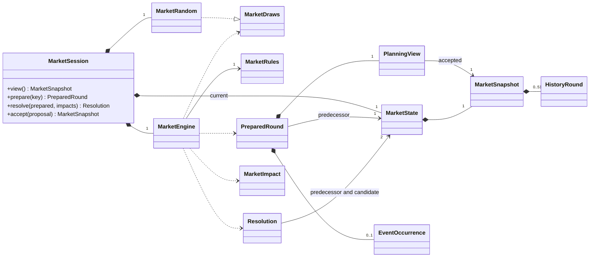
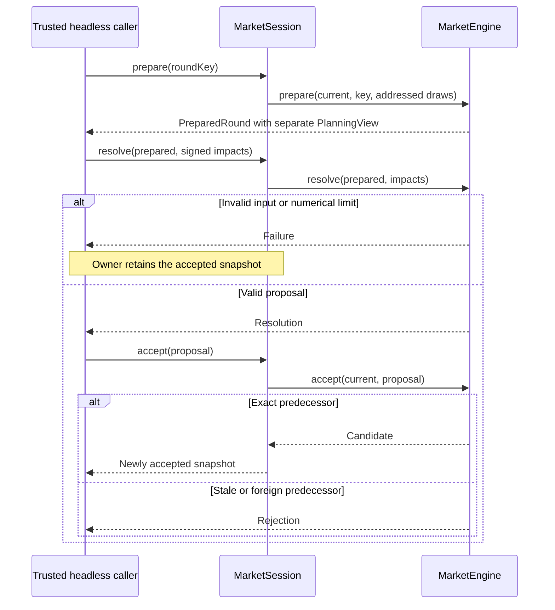

# Phase 03 market simulation

`domain.market` contains the rules, fixed-point arithmetic, accepted state and pure simulation. The Java 21 application module depends on domain and supplies the addressed RNG and headless owner in `application.market`. The presentation module depends on application and libGDX. Desktop assembles application and presentation with LWJGL3. Neither desktop nor presentation instantiates the market owner. The [Phase 02 domain model](domain-model.md) remains the contract for `GameSession`, `GameRun` and settlement.



| Step | Owns | Publication |
|---|---|---|
| Initialize | The owner holds sequence 0 with five opening indices, opening regime, empty returns and empty history | Accepted snapshot is readable |
| Prepare | The exact predecessor, next round key, mood, addressed noise and optional latent event are frozen in `PreparedRound` | `PlanningView` projects key, mood and past accepted data |
| Resolve | The trusted `Resolution` carries the predecessor, candidate and five attributions | Owner still holds the predecessor |
| Accept | The owner checks exact predecessor identity and swaps the accepted reference | The five aligned moves enter bounded history together |



One owner serializes prepare, view and accept. It can resolve multiple candidates against the same frozen context and accept one. Rereading, retrying or resolving has no side effects. Matching rules content is required throughout. A different owner with identical rule content and `RunId` still has a separate predecessor. History drops its oldest entry at capacity and keeps the latest effective returns and index ticks. State and public maps/lists are immutable. The trusted preparation and proposal types expose diagnostic event and attribution data. A future player adapter receives only `PlanningView` and accepted `MarketSnapshot`.

## Return and index

All six contributions and effective returns use signed integer basis points. For example, 882 bps is 8.82%. Sensitivities and volatility use per-mille. Transition weights and occurrence chances use probability bps. Signed division rounds nearest with ties away from zero.

1. Each noise sample averages two uniform integer draws in inclusive `[-amplitude, +amplitude]`. Regime volatility scales the common noise and each stock's own noise.
2. Per-stock common and mood betas scale the shared noise and regime drift. Previous **accepted** effective return supplies momentum, scaled by its weight and symmetrically capped. Momentum is zero before the first accepted return.
3. One latent event may apply a signed, sensitivity-scaled, capped shock to its targets. Signed external impacts are summed per stock before applying the news cap once. Report-only and fundamental references must carry zero signed impact and identify the exact occurrence.
4. Sum mood, common, own, momentum, event and news in wide arithmetic. Apply the final return interval. The recorded adjustment plus the raw sum equals the effective return.
5. Update with `round(oldTicks × (10000 + effectiveBps) / 10000)` using a `BigInteger` intermediate. One index unit is 10¹⁰ ticks. Each stock opens at 100 index units. Values outside 10,000 through 10¹⁸ ticks fail explicitly without acceptance. Zero return leaves ticks unchanged. Endless needs a numerical-limit policy in Phase 08.

Configuration validates exact stock and regime coverage, 10,000-weight transition rows, bounded parameters, unique regime/event IDs, event catalog capacity 64, history capacity 1–512 and a catalog when any event chance is positive. Inputs use existing enum identities. Impact lists are limited to 64 unique IDs with signed values in ±3000 bps. See the [design addendum](../design/phase-03-market-design-addendum.md) for the provisional parameters.

## Replay

`MarketRules.fingerprint()` is lowercase SHA-256 hex of UTF-8 text. Each row has a trailing `|` after every field and ends in ASCII LF. Rows are schema `market-rules-v1` and rules version, the settings in record field order, then stock/profile rows, regime parameter and transition rows, and event metadata and target rows. Stock order is Stable, Growth, Volatile, Follower, Wildcard. Regime order is Bull, Bear, Sideways, High Volatility, Crash, Recovery. Event order is ascending by ID, with target rows in stock order. Enum names use their Java identifiers. Numbers use decimal ASCII.

`MarketRandom` hashes these fields in order with SHA-256. All integral fields are big-endian. Each text field is a 32-bit byte length followed by UTF-8 bytes.

```text
text("bullbear-market-rng-v1"), signed int64 root seed, raw 32-byte rules digest,
int64 absolute round ordinal, text(channel), text(subject), int32 draw index
```

The first eight digest bytes form a signed Java seed for `SimulationRandom.seeded(seed).nextInt(bound)`. Opening ordinal is 1 and increases across stages. The opening mood is fixed by rules. Later rounds sample the prior accepted mood's transition row. Transition subject is the prior mood name, stock noise subject is the stock name, and other subjects are empty. Noise uses draw indices 0 and 1. All other channels use index 0. Run ID validates ownership and correlates occurrences. It is excluded from the RNG address. Same-schema replay also requires the same rules, seed and resolved impacts. Persisted replay compatibility across versions is deferred.

The golden fixture for `phase03-v1` uses root seed `Long.MIN_VALUE`. In round one it selects `PRODUCTIVITY_UPLIFT` and yields `[327, 71, -64, 851, 1054]` bps in stock order. The address and return expectations were calculated independently using SHA-256, the specified Java Random LCG, and integer arithmetic.

## Integration after Phase 03

Phase 04 can use the frozen occurrence to construct claims. It owns truth, visibility and converting each legitimate influence to a signed impact, including hidden news. One fundamental event shock is already applied by the engine. Separate sentiment needs its own defined cause and ID. Market inputs carry no source access or truth metadata.

Phase 05 should use one coordinator for `GameRun` and market state. Under the same exclusive owner boundary, it should validate the candidate predecessor, use the matching `Investment.Commitment` to build and validate a settlement, call `GameRun.settle`, then install the already validated market candidate by a nonfailing reference assignment. Publish snapshots only after both changes. `GameRun.settle` computes next wallet, special currency, shop and result before its first write. If settlement rejects, the market reference remains on the predecessor. The current `Investment.Movement` supports `UP` and `DOWN`. Phase 05 must decide how zero bps maps into result presentation and settlement. The effective return is the handoff value for whole-Coin settlement.
